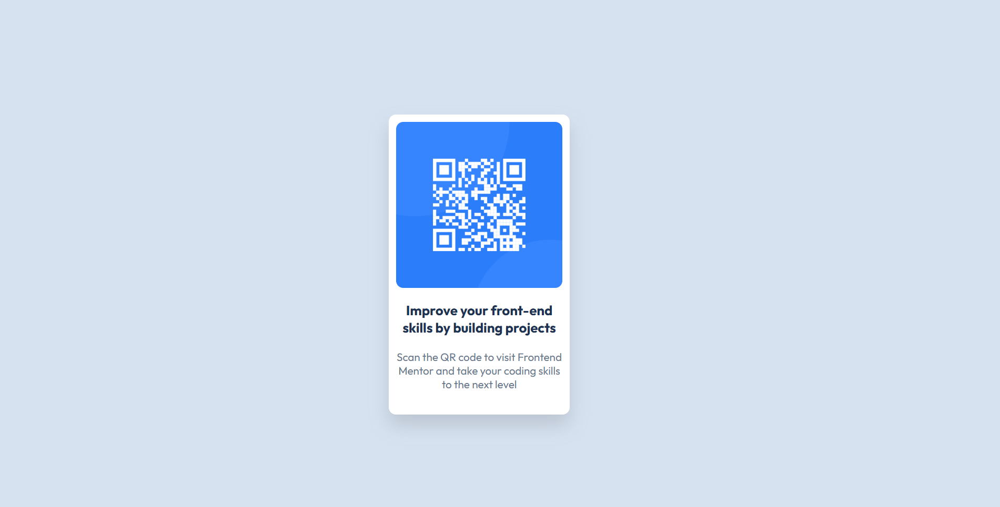

# Frontend Mentor - QR Code Component

This is my solution to the [QR code component challenge on Frontend Mentor](https://www.frontendmentor.io/challenges/qr-code-component-iux_sIO_H).

## Screenshot

## Built With

- HTML5
- CSS3
- Flexbox
- Google Fonts (Outfit)

## What I Learned

- Using Flexbox to center a component vertically and horizontally.
- Styling a card with rounded corners and box shadows.
- Adding background images and using custom fonts in CSS.

## Links

- Solution URL: [Add your solution URL](https://www.frontendmentor.io/solutions/--html5---css3---flexbox---google-fonts-outfit-M3P0qEFzFd)
- Live Site URL: [Add your live site URL](https://98dinesh89.github.io/Frontend-Mentor-QR-code-component/)

## Author

- Frontend Mentor: [@98Dinesh89](https://www.frontendmentor.io/profile/98Dinesh89)
